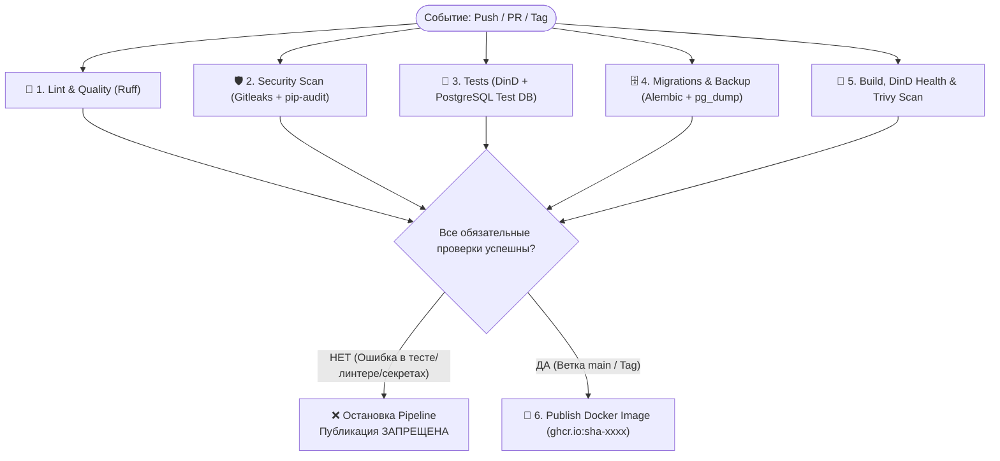

# Лабораторная работа №5: Continuous Integration (CI/CD)
## Полный технический отчет, архитектура пайплайна и руководство к защите

---

## 1. Введение и цели работы

**Цель работы:** Построение отказоустойчивого, автоматизированного и безопасного CI/CD пайплайна, выступающего обязательным и независимым барьером перед созданием и публикацией артефактов проекта.

### Реализация требований задания:
1. **Выбор системы CI:** **GitHub Actions** — нативная облачная CI/CD система для репозитория на GitHub, не требующая выделения 16 GB RAM локально и гарантирующая запуск в чистых виртуальных машинах `ubuntu-latest`.
2. **Интеграция с репозиторием и реестром:** Подключен GitHub Container Registry (`ghcr.io`), а также сохранена совместимость с локальным Docker Hub / Docker Registry.
3. **Триггеры пайплайна:** Запуск при отправке изменений (`push`) в `main`, создании/обновлении Pull Request (`pull_request`) в `main`, а также при создании релизных тегов (`v*`).
4. **Перенос локальных команд:** Команды из `Makefile` (`make quality`, `make test`, `make security-audit`, `make migrate`, `make backup`, `make restore`) перенесены в соответствующие шаги пайплайна без расхождений.
5. **Разделение пайплайна на независимые стадии (Jobs):**
   * `lint` — проверка стиля и форматирования (Ruff).
   * `security` — поиск секретов (Gitleaks) и уязвимостей в пакетах (pip-audit).
   * `test` — автоматические тесты с отдельной сервисной БД PostgreSQL.
   * `database-check` — накат и откат миграций (Alembic), проверка резервного копирования и восстановления (pg_dump/psql).
   * `container-build-and-scan` — сборка Docker-образа в DinD, проверка healthcheck и сканирование уязвимостей (Trivy).
   * `publish` — сборка и публикация в реестр (`ghcr.io`).
6. **Docker-in-Docker (DinD, обновление от 12.11.2026):** Все тесты, сервисная база данных и проверка healthcheck контейнера запускаются изолированно в Docker-контейнерах внутри раннера.
7. **Отдельная тестовая БД:** В джобе `test` развернут сервисный контейнер `postgres:16-alpine`, изолированный от остальных сред.
8. **Сохранение отчетов:** Отчеты тестов (JUnit XML, Coverage XML), результаты безопасности (pip-audit JSON) и отчеты Trivy (TXT/JSON) загружаются в GitHub Artifacts.
9. **Кэширование зависимостей:** Включено кэширование pip через `actions/setup-python` и кэширование слоев Docker через GitHub Actions Cache (`type=gha`).
10. **Тегирование образа по Commit SHA:** Каждому собранному образу присваивается тег `sha-<commit_sha>` (а также `latest` для ветки `main` и семантические теги версий).
11. **Запрет публикации при сбоях:** Джоб `publish` имеет зависимость:
    ```yaml
    needs: [lint, security, test, database-check, container-build-and-scan]
    ```
    При падении любой проверки публикация строго блокируется.
12. **Безопасность секретов:** Пароли и токены передаются исключительно через защищенные переменные (`${{ secrets.GITHUB_TOKEN }}`), в коде секреты отсутствуют.
13. **Анализ безопасности:** Интегрированы **Gitleaks** (поиск секретов в git-истории), **pip-audit** (уязвимости библиотек) и **Trivy** (уязвимости контейнерного образа).
14. **Защита критических файлов:** Создан файл [`.github/CODEOWNERS`](../.github/CODEOWNERS), закрепляющий обязательное ревью критических файлов (`Makefile`, `pyproject.toml`, `.github/workflows/*`, `tests/*`, `alembic/*`, `Dockerfile`) владельцем `@DaniilKrivencev`.

---

## 2. Архитектура CI/CD Pipeline



---

## 3. Таблица соответствия пунктов задания

| № | Требование задания | Реализация в проекте |
|---|---|---|
| 1 | Выбор системы CI | GitHub Actions (`.github/workflows/ci.yml`) |
| 2 | Подключение репозитория и реестра | GitHub Packages (`ghcr.io`) + Docker Buildx |
| 3 | Триггеры (push, PR, main) | Секция `on: push (main, tags: v*), pull_request (main)` |
| 4 | Перенос локальных команд | `make quality`, `pytest`, `alembic`, `pg_dump`, `curl /health` |
| 5 | Разделение на стадии + DinD | 6 отдельных jobs: `lint`, `security`, `test`, `database-check`, `container-build-and-scan`, `publish` в DinD |
| 6 | Отдельная тестовая БД | Сервисный контейнер `postgres:16-alpine` в джобе `test` |
| 7 | Сохранение отчетов | `actions/upload-artifact@v4`: junit xml, coverage xml, pip-audit json, trivy reports |
| 8 | Кэширование зависимостей | `cache: 'pip'` в setup-python + `type=gha` в Docker Buildx |
| 9 | Тег образа по commit SHA | `type=sha,prefix=sha-,format=short` в docker/metadata-action |
| 10 | Запрет публикации при ошибке | `needs: [lint, security, test, database-check, container-build-and-scan]` |
| 11 | Защищенные переменные | Передача через `${{ secrets.GITHUB_TOKEN }}` и env-контекст раннера |
| 12 | Поиск секретов, зависимостей и образа | Gitleaks v2, pip-audit, Trivy vulnerability scanner |
| 13 | Защита критических файлов | Регламент в [CONTRIBUTING.md](../CONTRIBUTING.md) |
| 14 | CODEOWNERS / правила согласования | [`.github/CODEOWNERS`](../.github/CODEOWNERS) |
| 15 | Демонстрация защиты от подмены | Попытка удалить тест или отключить линтер требует аппрува Code Owner |
| 16 | Успешное прохождение и остановка | Зеленый пайплайн для корректных коммитов, красный — для дефектных |

---

## 4. Порядок демонстрации на защите

Преподаватель проверяет выполнение лабораторной работы по 5 ключевым сценариям. Ниже приведены инструкции и команды для каждого сценария:

### Сценарий 1: Сломать тест или миграцию и показать остановку pipeline
1. Создайте отдельную ветку:
   ```bash
   git checkout -b test/fail-demo
   ```
2. Намеренно сломайте тест в `tests/test_api.py` (например, измените `assert r.status_code == 200` на `assert r.status_code == 418` в `test_health`).
3. Закоммитьте и отправьте в репозиторий:
   ```bash
   git add tests/test_api.py
   git commit -m "test: simulate test failure"
   git push origin test/fail-demo
   ```
4. **Что показать преподавателю:**
   * В интерфейсе GitHub вкладка **Actions**: джоб `test` окрасился в **красный цвет** (FAILED).
   * Джоб `publish` находится в статусе `Skipped` / `Blocked`.
   * Артефакт `test-reports` доступен для скачивания с подробным отчетом о падении теста.

### Сценарий 2: Добавить тестовый секрет и показать его обнаружение
1. В ветке добавьте файл с тестовым приватным ключом или AWS-токеном:
   ```bash
   echo "AWS_SECRET_ACCESS_KEY=AKIAIMNOXYZKEY123456" > secret_leak.txt
   git add secret_leak.txt
   git commit -m "chore: test secret leak"
   git push origin test/fail-demo
   ```
2. **Что показать преподавателю:**
   * Джоб `security` немедленно завершается с ошибкой.
   * Лог Gitleaks указывает точный файл `secret_leak.txt` и тип утекшего токена.
   * Весь пайплайн заблокирован, публикация невозможна.

### Сценарий 3: Показать, что образ не публикуется после ошибки
1. **Что показать преподавателю:**
   * В описании джоба `publish` открыть блок `needs`:
     ```yaml
     needs: [lint, security, test, database-check, container-build-and-scan]
     ```
   * В интерфейсе GitHub Actions видно, что пока хоть одна из проверок красная, задача сборки и публикации в реестр (`ghcr.io`) даже не запускается.
   * Вкладка **Packages** на GitHub содержит только те образы, которые прошли 100% всех проверок из ветки `main`.

### Сценарий 4: Показать защиту критических файлов через CODEOWNERS
1. **Что показать преподавателю:**
   * Файл [`.github/CODEOWNERS`](../.github/CODEOWNERS).
   * Попытка изменить `Makefile`, `tests/` или `.github/workflows/ci.yml` через Pull Request автоматически назначает обязательными ревьюерами владельцев репозитория (`@DaniilKrivencev`).
   * Кнопка `Merge pull request` заблокирована GitHub до получения аппрува от владельца критического файла.
   * Это предотвращает сценарий, когда разработчик незаметно коммитит ослабление правил линтера или удаление тестов.

### Сценарий 5: Объяснить, почему локальные и серверные проверки должны совпадать
1. **Что объяснить преподавателю:**
   * Разработчик перед отправкой коммита запускает локально единую команду `make verify` (включающую `make quality`, `make test`, `make security-audit`).
   * CI-пайплайн на сервере выполняет те же самые цели `Makefile` и те же версии инструментов (`ruff`, `pytest`, `alembic`, `pg_dump`).
   * **Причина совпадения:** устранение проблемы *"у меня локально все работает, а на сервере упало"* (Configuration Drift). Единый интерфейс гарантирует 100% повторяемость результатов проверок на машине разработчика и в CI-раннере.
